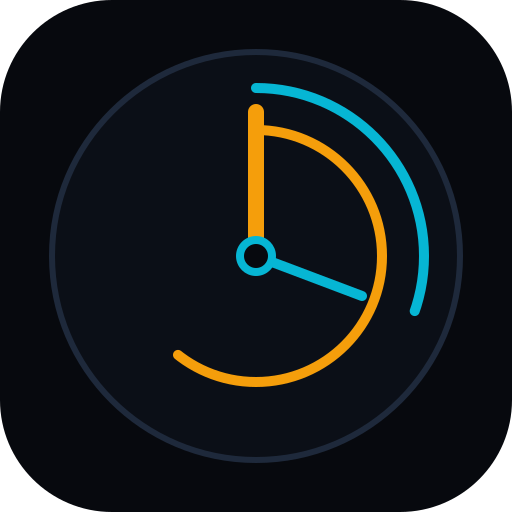

<div align="center">



# OddClock

**Reinvent the 24-hour clock. Divide Earth's day into any fraction, lock ticks to any frequency, hear the harmonic tempo, and export straight to Android, Apple, or PWA.**

[](LICENSE)
[](tsconfig.json)
[](package.json)
[](Cargo.toml)
[](vite.config.ts)

</div>

---

## Why OddClock?

Standard time (`24h · 60m · 60s @ 1.000 Hz`) is a Babylonian habit, not a law of physics.

**OddClock** lets you engineer custom temporal systems in real time—whether you want metric **10h · 100m · 100s** French Decimal time, a binary **16h · 64m · 64s** clock, an **18h · 80m · 120s** musician's `120 BPM` metronome day, or a custom oscillator running at **7.83 Hz / 4 = 1.9575 Hz** Schumann sub-harmonic resonance.

---

## Core Features

### 1. Arbitrary Time Division & Oscillator Modes
- **Solar Day Lock**: Divide the `86,400`-second solar day cleanly into custom **Hours (`2–60`) × Minutes (`4–120`) × Seconds (`4–120`)**.
- **Frequency Oscillator Mode**: Lock ticks directly to any custom cadence (`0.10 Hz – 12.00 Hz`) and watch how the resulting alternate day stretches or compresses relative to Earth time—complete with live `+Nd` rollover date tracking.
- **Zero-Dependency Rust Math Kernel**: Reference horological engine in [`src/engine/chronos_engine.rs`](src/engine/chronos_engine.rs) with `Cargo.toml` unit test suite alongside the real-time TypeScript engine.

### 2. Four Mathematically Driven Visualizers
| View | How It Works |
| :--- | :--- |
| **Analog** (`phase-dial`) | Concentric phase dial where radial Hour, Minute, and Second hand tips align strictly with their own custom-divided ring scales. |
| **Harmonic** (`lissajous`) | Live Lissajous orbital phase figure driven by simplified coprime ratios of your clock's subdivisions (`H:M:S`) with an independent animation speed slider. |
| **Wave** (`spectrum`) | Real-time harmonic waveform summing active Day, Hour, Minute, and Second carrier frequencies. |
| **Spiral** (`spiral`) | Archimedean helix with `H` full coils (1 full revolution = 1 custom hour) aligned with `0..M` radial minute spokes and a center hour badge. |

### 3. Time Dilator Mode
- **OddClock vs. Earth Comparison**: Switch to **Time Dilator** to track elapsed Earth time against your custom OddClock time across **Live Timer**, **Today**, **24h Day**, and **1 Year** horizons.
- **Perceived Time Gain & Stretch Visualization**: Dual-stream telemetry bars compare beat cadence (`Hz`) and day-cycle velocity (`days / 24h`) while showing exact beat deltas, subjective day gain/loss, and unit equivalences (`1 Odd Tick`, `1 Odd Min`, `1 Odd Hour`).

### 4. Harmonic Web Audio Synthesizer
- Shifts your sub-audible tick frequency (`tickHz`) up by pure power-of-two octaves (`2^n`) into the `220–440 Hz` musical range (`findAudibleOctave`).
- Synthesizes clean procedural chimes across **Pentatonic**, **Quartz**, and **Schumann** scales using native Web Audio API oscillators.

### 5. Shareable Clock Permalinks & Accent Themes
- **1-Tap Share Button**: Generates portable deep-link URLs encoding your exact clock topology, anchor mode, Hz rate, active visualizer, sweep style, animation speed, and accent color (`?h=10&m=100&s=100&mode=solar&view=phase-dial&sweep=smooth&accent=06B6D4`).
- **Custom Accent Theme Picker**: Choose from curated presets (*Quantum Cyan*, *Cobalt Blue*, *Emerald Pulse*, *Ultraviolet*, *Crimson Rose*, *Solar Amber*) or any custom HEX color—applied dynamically across every canvas visualizer, digital glow, and exported native widget.

### 6. Install Anywhere: PWA, Android APK Project, Apple WidgetKit
- **1-Click PWA Install**: Offline-ready service worker + install prompt for Android Chrome, macOS/Windows Desktop, and iOS Safari *Add to Home Screen*.
- **Android APK Project Export (`.zip`)**: Generates a complete, zero-setup Gradle 8.7 / Kotlin / **Jetpack Glance 1.1.0** Android home-screen widget + pinning launcher app (`OddClockWidget.kt`, `MainActivity.kt`, GitHub Actions APK build workflow included).
- **Apple WidgetKit Export (`.swift`)**: Ready-to-drop SwiftUI `TimelineProvider` widget configured for your custom day fractions and chosen accent palette.

---

## Built-In Clock Presets

| Preset | Topology | Anchor Mode | Tick Rate | Best Visualizer |
| :--- | :--- | :--- | :--- | :--- |
| **French Decimal** | `10h · 100m · 100s` | Solar (`100,000` ticks/day) | `1.1574 Hz` | Analog |
| **120 BPM Allegro** | `18h · 80m · 120s` | Solar (`172,800` ticks/day) | `2.0000 Hz` | Wave |
| **Hexadecimal 16-Bit** | `16h · 64m · 64s` | Solar (`65,536` ticks/day) | `0.7585 Hz` | Harmonic |
| **Dozenal Symmetry** | `12h · 12m · 144s` | Solar (`20,736` ticks/day) | `0.2400 Hz` | Spiral |
| **Schumann Sub-Harmonic** | `16h · 45m · 60s` | Frequency Lock | `1.9575 Hz` | Harmonic |
| **Earth Standard** | `24h · 60m · 60s` | Solar (`86,400` ticks/day) | `1.0000 Hz` | Analog |

---

## Quick Start

### Web App (React + TypeScript + Vite)

```bash
git clone https://github.com/oddclock/oddclock.git
cd oddclock
npm install
npm run dev
```

Open `http://localhost:3000`.

### Build & Type-Check

```bash
npm run lint
npm run build
```

### Rust Horological Math Kernel

```bash
cargo test
```

---

## Architecture

```text
├── Cargo.toml                         # Rust library crate manifest (chronos_engine)
├── src/
│   ├── App.tsx                        # Main glassmorphism widget, Tune panel, permalink sync & share action
│   ├── components/
│   │   ├── ClockVisuals.tsx           # 4-mode SVG/canvas horological renderer (Analog, Harmonic, Wave, Spiral)
│   │   ├── PWAInstallButton.tsx       # Cross-platform PWA install handler & Android/iOS helper states
│   │   └── WidgetStudioModal.tsx      # PWA install modal, Apple WidgetKit & Android Jetpack Glance ZIP export
│   ├── engine/
│   │   ├── clockEngine.ts             # Core alternate-time math, presets, date offset, hex utilities & URL parser
│   │   ├── chronos_engine.rs          # Zero-dependency Rust horological engine & unit tests
│   │   ├── audioSynth.ts              # Procedural Web Audio harmonic chime synthesizer
│   │   └── widgetCodeGen.ts           # Swift WidgetKit & Android Kotlin/Gradle project generator
│   ├── hooks/
│   │   └── usePWAInstall.ts           # beforeinstallprompt + platform/standalone detector
│   └── utils/
│       └── zipBuilder.ts              # Pure TypeScript Store-mode PKZIP archive builder (CRC-32)
└── .github/
    ├── workflows/ci.yml               # Automated TypeScript lint, Vite production build & Rust cargo test
    ├── ISSUE_TEMPLATE/                # Bug report & custom clock preset submission templates
    └── PULL_REQUEST_TEMPLATE.md       # Clean PR checklist
```

---

## Contributing

Contributions are welcome! Want to add a new historical calendar, a fractal clock visualizer, or WearOS/watchOS widget exports? Read [CONTRIBUTING.md](CONTRIBUTING.md) or submit a [Custom Clock Preset](.github/ISSUE_TEMPLATE/custom_clock_preset.md).

## License

Released under the [MIT License](LICENSE).
